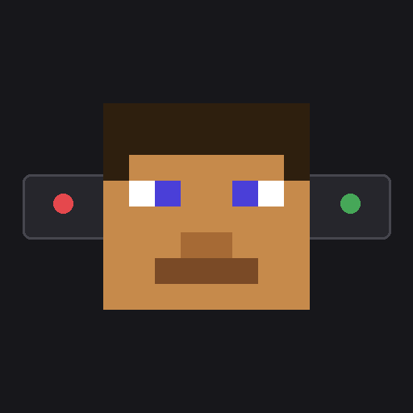

# horizon-locator-heads

<p align="center"></p>

<p align="center">
  <a href="https://github.com/SkyeSlav/horizon-locator-heads/releases/latest"></a>
  <a href="https://github.com/SkyeSlav/horizon-locator-heads/actions/workflows/release.yml"></a>
  <a href="LICENSE"></a>
</p>

Player heads on the locator bar for Horizon/Starling: every other player on the server shows as their head instead of a coloured dot. Based on the idea behind [Locator Heads](https://github.com/Haage001/locator-heads) by Haage001.

> **Releases:** grab the ready-built file from the [latest release](https://github.com/SkyeSlav/horizon-locator-heads/releases/latest) — no build needed. `locator-heads-1.0.0.hnmod` is for Starling 0.8.0.

- **Heads replace the dots** — no dot shows under a head, at any distance. Heads slide along the bar as you turn and shrink with distance the same way vanilla does, and work for far away players too, not just ones close by.
- **Heads only when the locator bar shows** — pick up XP and they hide for a few seconds while the XP bar is up, then come back.
- **Compass** — N/E/S/W letters over the bar, or coordinates if you prefer, with a shadow toggle.
- **Borders** — team colour, or a colour you pick with `/lh bordercolor <hex>`.
- **Names** — off, always, looking at, or while the player list is open. Names take the border colour and slide in.
- **Filtering** — include or exclude players by name.

## Install

### Starling (`.hnmod`, 1.0.0)

Build the `.hnmod` from this repo:

```sh
python3 tools/package.py        # target/locator-heads-1.0.0.hnmod
```

### Starling (Android)

Add `locator-heads-1.0.0.hnmod` in Starling's Native mods and build with your build server (Starling 0.8.0). The mod is source-only; the build server compiles it into the game library.

## Commands

- `/lh` — status: the settings and the filter lists.
- `/lh toggle` — turn the mod on/off.
- `/lh filter include <names>` — only these players get heads.
- `/lh filter exclude <names>` — these players never get heads.
- `/lh filter clear` — clear both lists.
- `/lh bordercolor <hex>` — the static border colour, e.g. `/lh bordercolor FF0000`.

The settings page (Options > Mods > Locator Heads) has the same settings as buttons. The filter lists are free text, so they are set with the commands above.

## How it works

- Heads come from the server's waypoint packets plus the loaded player mobs, so a head shows for a player at any distance. A loaded player always wins over its waypoint entry, so nobody draws twice.
- While the locator bar shows, the vanilla dots are suppressed and the mod redraws the bar itself — background, level number, dots for waypoints that are not players, and the up/down arrows — then the heads on top.
- Heads draw only when the locator bar is the current bar. On a server that never sends waypoint packets, no heads ever show.

## Layout

- `mixins/locator_heads/engine/`: the mod's own crate (std only), with its unit tests — bearings, the ±60° window, name modes, filters, compass, distance scaling, hex colours, the waypoint table and the loaded/waypoint merge.
- `mixins/locator_heads/*.rs`: one small hook adapter per hook point (packet, layer pre/post, command, commands, list, settings).
- `mixins/locator_heads/horizon-mixin.toml`: where each hook goes.
- `compatibility.json`: the Horizon and horizon-mixins pins.
- `tools/package.py`: makes the `.hnmod`.
- `tools/submit.py`: compiles it on a build server.
- `horizon-registry.toml`: name, summary, description, authors and license for the registry entry.

## License

MIT, see [LICENSE](LICENSE).
